# How to Update Your STEM with Ashley Website

*A step-by-step guide for Ashley. No coding needed.*

Your website has a private **admin dashboard** where you can change the content of
every app: career fields, majors, skills, resources, interview prep, and job listings.
You type into normal boxes, save, look at a preview, and click Publish. The website
updates itself in about a minute.

**The everyday routine:**
**Sign in → Choose what to change → Edit → Save draft → Preview → Publish → Check the website**

> **Good to know**
> - Nothing you do in the dashboard changes the public website until you click
>   **Publish**. Saved drafts are private.
> - Everything you publish is kept in **Version History**, so you can always go back.
> - You can't break the website from the dashboard. It checks your changes before
>   publishing and tells you exactly what to fix.

---

## 1. Open the admin website

Go to **<https://stem-with-ashley.vercel.app/admin/>**

Tip: bookmark this page so it's one click away.

## 2. Sign in

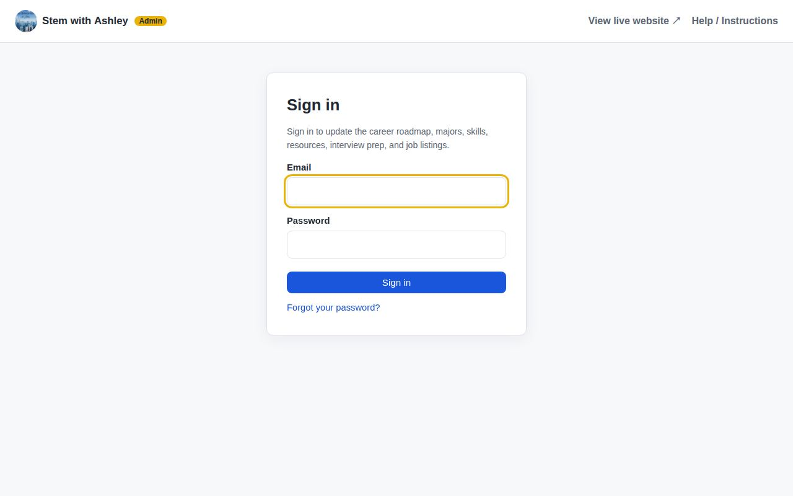

1. Type your email address.
2. Type your password.
3. Click **Sign in**.

**The first time only:** Shikhar sends you a one-time setup link. Click it, choose
a password (at least 10 characters; a short phrase you'll remember works well), and
click **Save password and continue**. After that, use the sign-in page above. The
setup link works once and expires, so if it doesn't work, ask Shikhar for a new one.

## 3. Reset your password

**If you're signed in:** go to **Settings** (left menu) → **Change your password**,
type the new password twice, and click **Change password**.

**If you forgot it:** on the sign-in page click **Forgot your password?**, type your
email, and click **Email me a reset link**. Open the email and click the link, then
choose a new password. If no email arrives within 10 minutes (check spam too), ask
Shikhar. He can create a reset link for you from **Settings → Team access**.

## 4. The dashboard

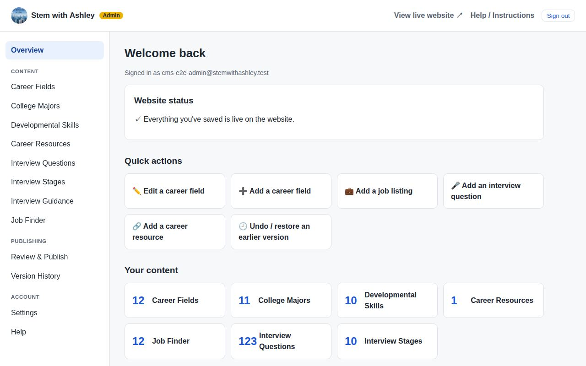

After you sign in, you see the **Overview** page:

- **Website status**: whether you have unpublished drafts.
- **Quick actions**: one-click shortcuts for common jobs.
- **Your content**: how many of each thing there are. Click a box to open it.
- **The live website**: links to every public app.
- **Recently published**: the latest updates.

The **left-hand menu** has every section. (On a phone, tap **☰ Menu** first.)

At the top right you'll always see **View live website**, **Help / Instructions**,
and **Sign out**.

## 5. Find existing content

1. Click a section in the left menu, such as **Career Fields**.
2. You'll see a list. Type in the **Search** box to filter it. For example, type
   "civil" to find Civil Engineering.
3. Click the item's name (or **Edit**) to open it.

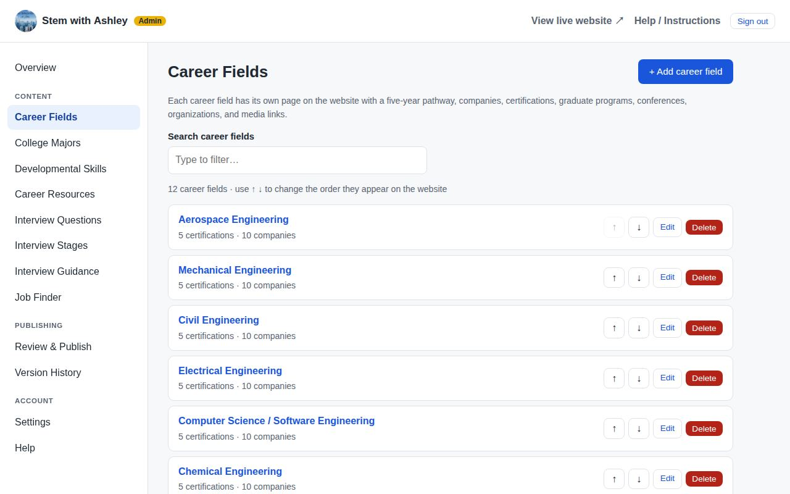

Labels in the list tell you what's happening:

- **Edited — not published**: you've changed it in a draft, but the website still
  shows the old version.
- **New — not published**: you added it, but it isn't on the website yet.

## 6. Edit a career field

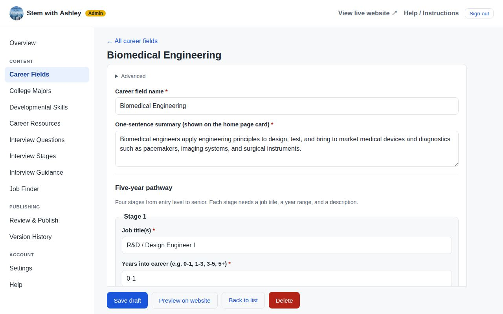

1. Go to **Career Fields** and click the field.
2. Change any box: the name, the one-sentence summary, and so on. Boxes marked
   **\*** are required.
3. Click **Save draft** at the bottom.

You'll see "Draft saved". Your change is stored safely but isn't on the website yet.

## 7. Create a new career field

1. Go to **Career Fields** and click **+ Add career field** (top right).
2. Fill in the **name** and **summary**.
3. Fill in all **four pathway stages** (see the next step).
4. Add companies, certifications, graduate programs, conferences, organizations,
   and YouTube/podcast links as you like.
5. Click **Save draft**.

The website address for the new field is created automatically from its name.

## 8. Change the five-year pathway

Every career field has exactly **four stages**, from entry level to senior. For
each stage, fill in:

- **Job title(s)**, e.g. "Design Engineer I / Associate Engineer"
- **Years into career**, e.g. `0-1`, `1-3`, `3-5`, `5+`
- **What this stage looks like**: a sentence or two

## 9. Edit certifications and web links

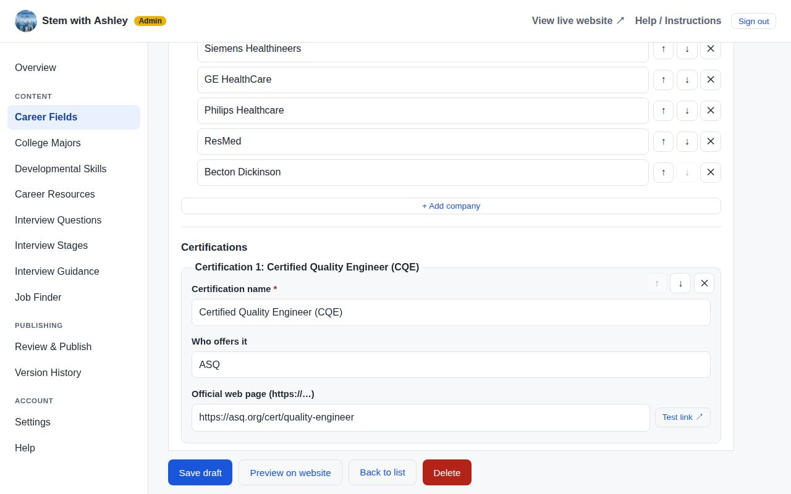

- To **change** one, edit its boxes.
- To **add** one, click **+ Add certification**, then fill in the name, who offers
  it, and its official web page.
- To **remove** one, click the **✕** next to it.
- To **reorder**, use the **↑ ↓** arrows.

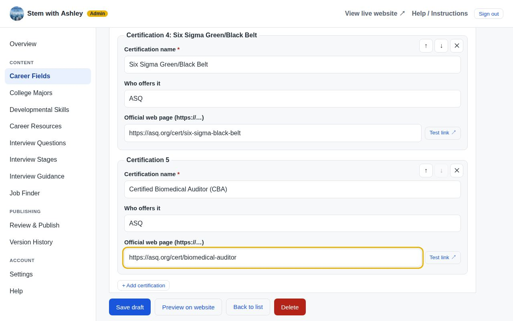

**Web addresses must start with `https://`.** The easiest way is to open the page
in your browser, copy the address from the address bar, and paste it in. A
**Test link ↗** button appears so you can check it opens the right page.

Companies, conferences, organizations, and schools work the same way: each one is
its own line with **+ Add**, **✕**, and **↑ ↓**.

## 10. Edit majors

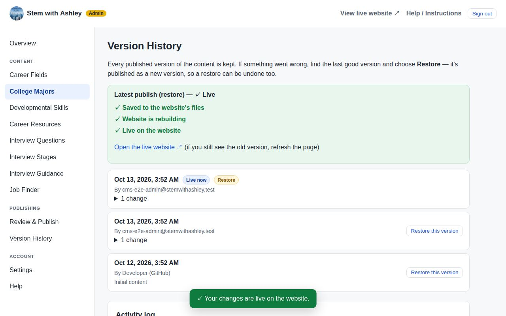

Go to **College Majors**. Each major has a name, a summary, typical courses (one per
line), why students choose it, and the **career fields it leads to**. Tick the
boxes for those fields. Every major must link to at least one career field.

## 11. Update career resources

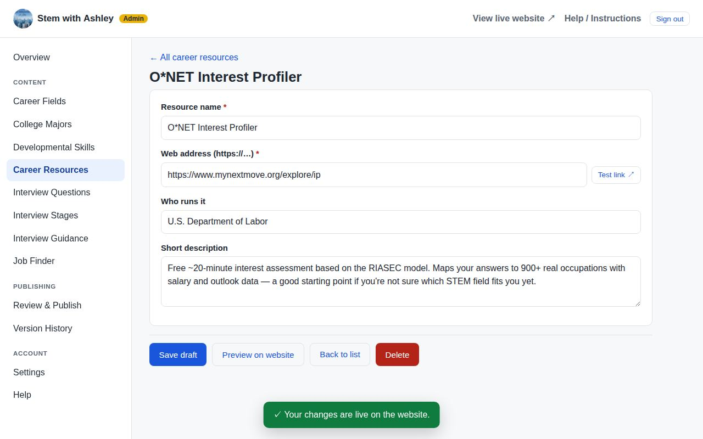

Go to **Career Resources**. Each resource needs a name and a web address, plus
optionally who runs it and a short description. These appear on the website's
**Resources** page.

## 12. Add or edit developmental skills

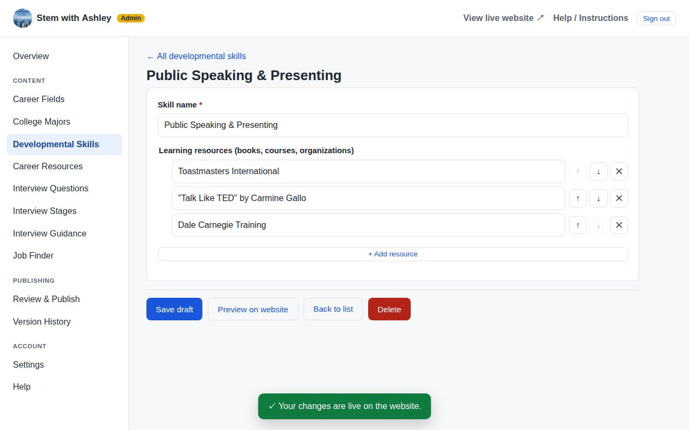

Go to **Developmental Skills**. Each skill has a name and a list of learning
resources (books, courses, organizations), one per line.

## 13. Update interview questions

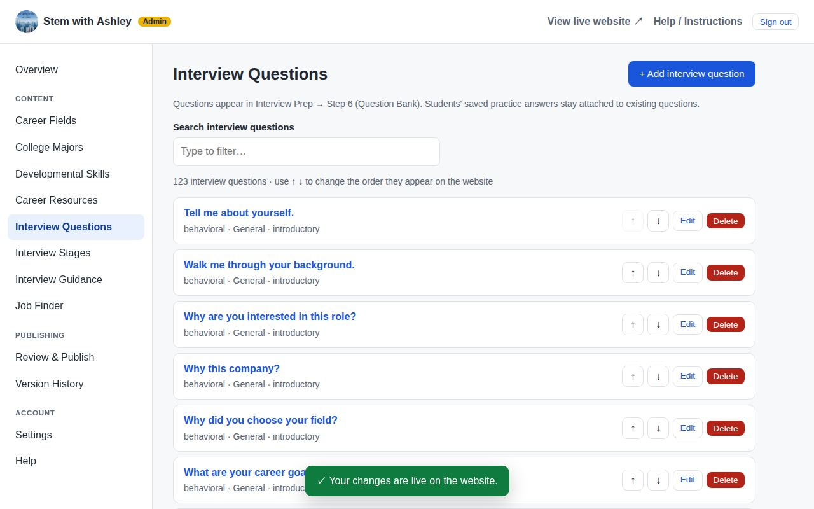

Go to **Interview Questions**. Each question has a category (Behavioral,
Situational, or Technical), a topic, a difficulty level, what it evaluates, a tip,
and search tags.

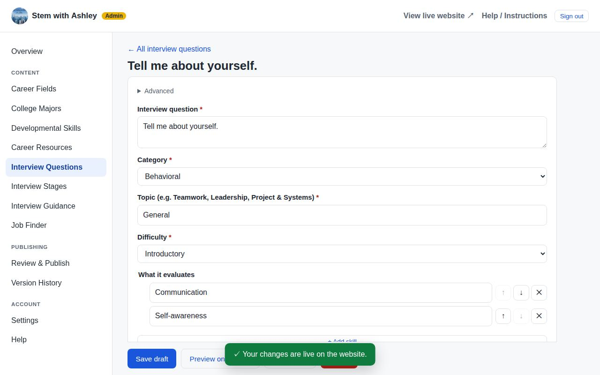

- **Editing an existing question is safe.** Students' saved practice answers stay
  attached to it.
- **Deleting a question** removes it for everyone, including any practice answers
  students saved for it.

Also in this area:

- **Interview Stages**: the stages listed in Interview Prep, Step 2.
- **Interview Guidance**: the STAR "why it works" and "common mistakes" lists, the
  situational framework, the before/during/after checklists, and the questions
  students can ask the interviewer.

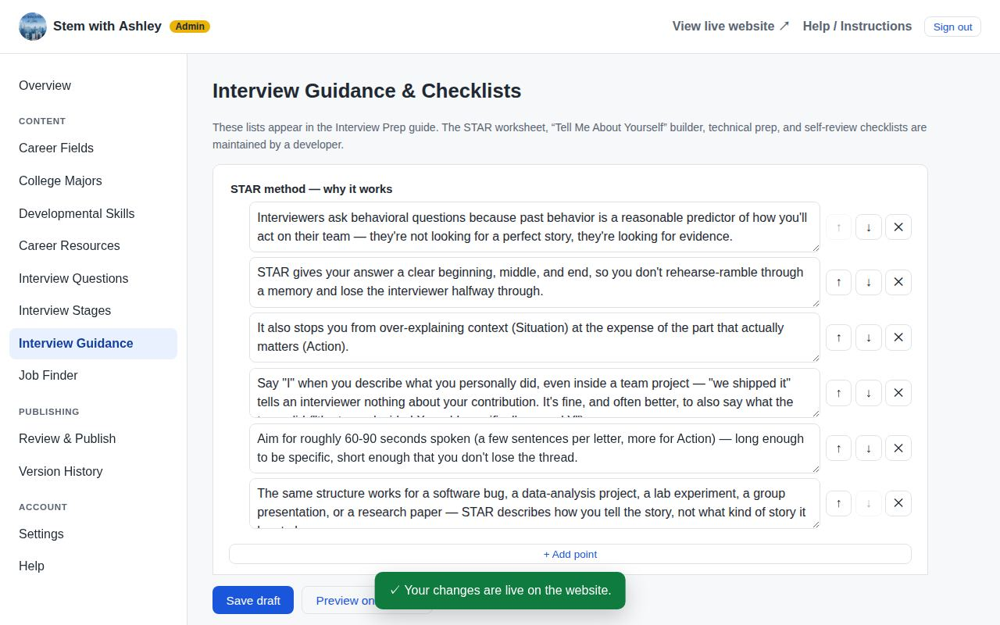

> Tip: students' checklist ticks are saved by position. If you insert an item in
> the middle of a checklist, a student's existing ticks may shift by one. Adding new
> items at the **end** avoids that.

## 14. Add or edit job listings

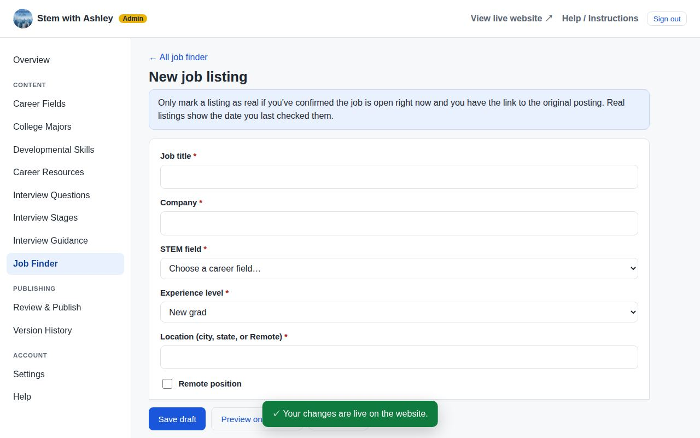

Go to **Job Finder** and click **+ Add job listing** (or click an existing one).
Fill in the title, company, STEM field, experience level, location, remote or not,
and a one-sentence description.

**Sample or real?**

- Leave **"This is a SAMPLE listing"** ticked for examples. The website shows them
  with a grey **Sample listing** label.
- Untick it **only** for a real job you've confirmed is open right now. Then paste
  the **link to the real job posting** and the **date you last checked it**. The
  website shows a green **Real listing** label and a "View the original posting"
  link.
- When a real job closes, delete it or tick "sample" again.

## 15. Save drafts

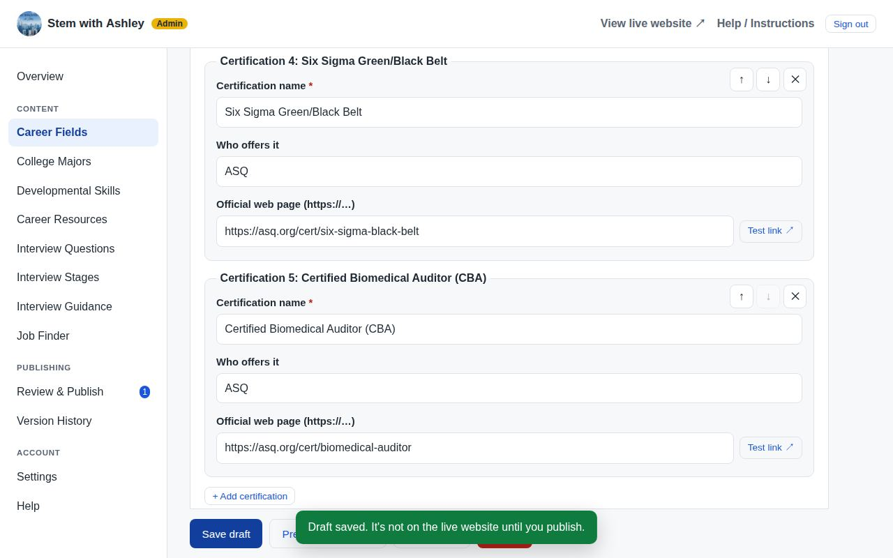

Click **Save draft** whenever you've made changes. Drafts are:

- **Private**: the public website doesn't change.
- **Safe**: they're kept even if you close the browser, sign out, or switch
  computers.
- **Forgiving**: you can save an unfinished draft. Anything that must be fixed
  before publishing is highlighted in red.

If you try to leave a page with changes you haven't saved, the dashboard asks
whether to **Save draft**, **Discard changes**, or **Keep editing**.

A yellow bar at the bottom of the screen reminds you when you have unpublished
changes.

## 16. Preview your changes

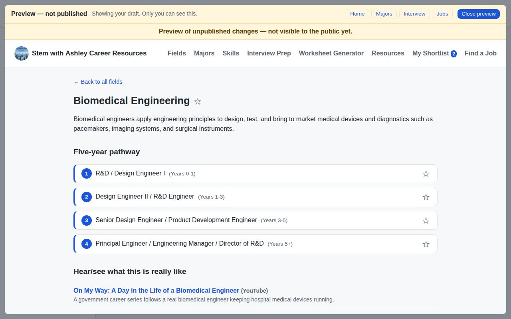

Click **Preview on website** at the bottom of any editing page. You'll see the real
website with your changes, inside a frame with a yellow
"Preview — not published" banner. Use the **Home / Majors / Interview / Jobs**
buttons to look around. Click **Close preview** when you're done.

Only you can see the preview.

## 17. Publish your changes

1. Click **Review & Publish** in the left menu (or the button on the yellow bar).
2. Check the list of changes. Each one is marked **added**, **edited**,
   **removed**, or **reordered**.

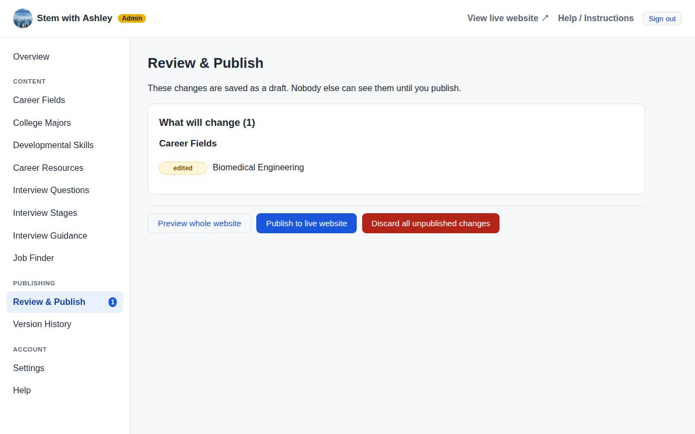

3. If anything needs fixing, a red box lists it. Click a problem to jump straight
   to it.
4. Click **Publish to live website**, then **Publish now** to confirm.

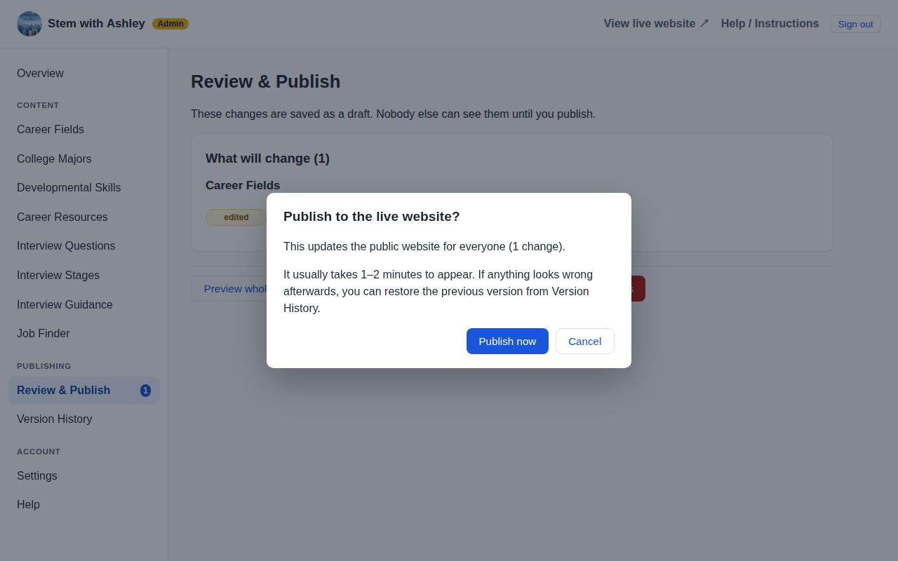

5. Watch the progress box. It shows ✓ **Saved to the website's files**, then
   ✓ **Website is rebuilding**, then ✓ **Live on the website**. This usually takes
   1–2 minutes. You can leave the page while it works.

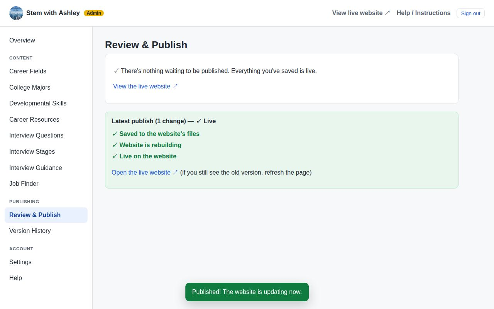

## 18. Check your changes on the public website

When you see **✓ Live**, click **Open the live website**. If you still see the old
version, refresh the page (press **F5**, or pull down on a phone). Browsers sometimes
show a saved copy for a moment.

## 19. Restore an earlier version (undo)

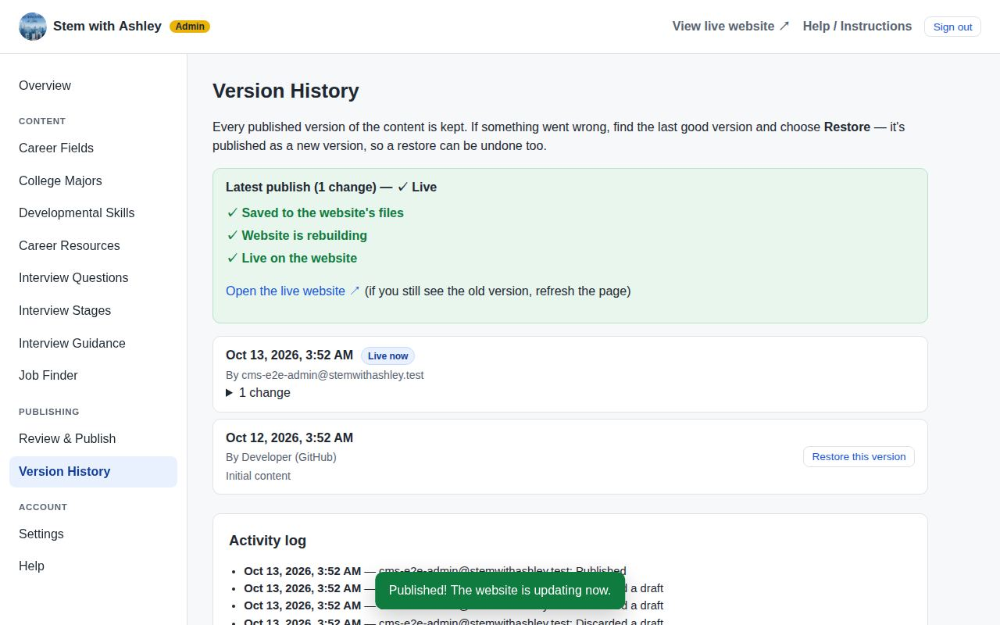

1. Click **Version History** in the left menu.
2. Each entry shows when it was published and who published it. Click
   **"N changes"** to see what changed.
3. Find the last version that was right and click **Restore this version**.
4. Read the message and click **Restore and publish**.

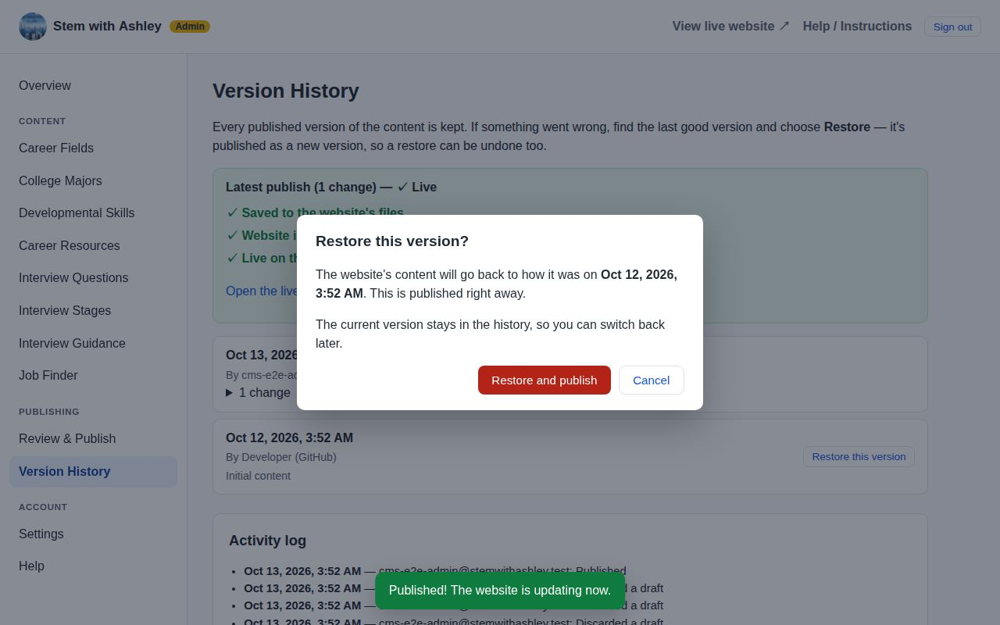

The website goes back to that version in 1–2 minutes. Restoring doesn't erase
anything. The version you replaced stays in the history, so you can switch back
again if you change your mind.

Restoring throws away any **unpublished drafts**, and the dashboard warns you first.

The **Activity log** at the bottom shows every publish, restore, and deletion, plus
anything that failed.

## 20. Sign out

Click **Sign out** at the top right. For safety, the dashboard also signs you out
after **30 minutes** without activity. It warns you 5 minutes before, and saves any
unsaved edits as a draft first.

## 21. When publishing doesn't work

Don't worry. **Nothing on the website breaks when publishing fails.** The old
version simply stays up, and your drafts are kept.

| What you see | What it means | What to do |
| --- | --- | --- |
| Red box: "must be fixed before publishing" | Something is missing or not in the right format | Click each problem, fix it, Save draft, then publish again |
| "The live website changed while you were editing" | Someone else (or Shikhar) updated the same content | **Keep my version** publishes yours; **Start over** loads the newest version. If unsure, choose Cancel and ask Shikhar |
| "Someone else published a change at the same moment" | Two publishes collided | Wait a minute and click Publish again |
| "Publishing isn't connected" / "publishing access has expired" | A setting on Shikhar's side needs renewing | Your drafts are safe. Contact Shikhar |
| Progress says **Failed** | The website couldn't rebuild | The old version is still showing. Contact Shikhar |
| "Taking longer than usual" | Website rebuilds are slow right now | Check back in a few minutes |
| "Your session has expired" | You were signed out | Sign in again. Your drafts are still there |

## 22. What needs a developer (Shikhar)

The dashboard covers all everyday content. Ask Shikhar for:

- Changing page layouts, colors, fonts, or the logo
- New kinds of content or new pages/apps
- The STAR worksheet, "Tell Me About Yourself" builder, technical-prep notes,
  self-review checklists, or the STAR example story
- How the Worksheet Generator creates questions
- Connecting a live job-listings feed
- Adding or removing people's dashboard access (if you don't have the
  Administrator role)
- Anything the dashboard says to "ask Shikhar" about

## Inviting a helper (Administrators only)

**Settings → Team access → Invite someone** creates a one-time sign-in link for a
new person. Choose **Editor** (can edit content) or **Administrator** (can also
manage who has access). Send them the link yourself. Never send anyone a password.
To remove someone's access, change their role to **No access**.

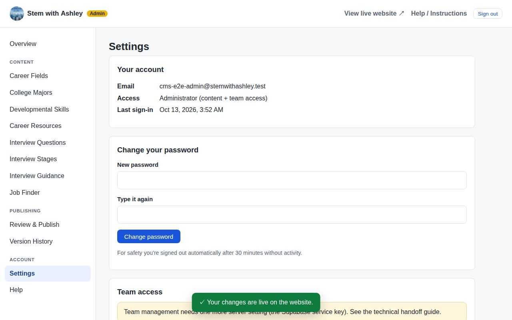
