# How to Use the STEM with Ashley Apps

*A guide to every app on the website: what it's for and how to use it.*

Website: **<https://stem-with-ashley.vercel.app>**

Anyone can use the website. No account or sign-in is needed. The menu at the top
of every page leads to each app: **Fields · Majors · Skills · Interview Prep ·
Worksheet Generator · Resources · My Shortlist · Find a Job**.

> **Privacy:** anything a visitor saves (bookmarks, interview practice answers,
> checklist ticks, worksheet notes) stays **in their own browser on their own
> device**. It is never uploaded, and nobody else (including you) can see it.
> Practice videos are never saved anywhere. They disappear when you leave the
> page. Saved items also don't follow someone to another computer or browser.

---

## 1. STEM Career Roadmap (home page)

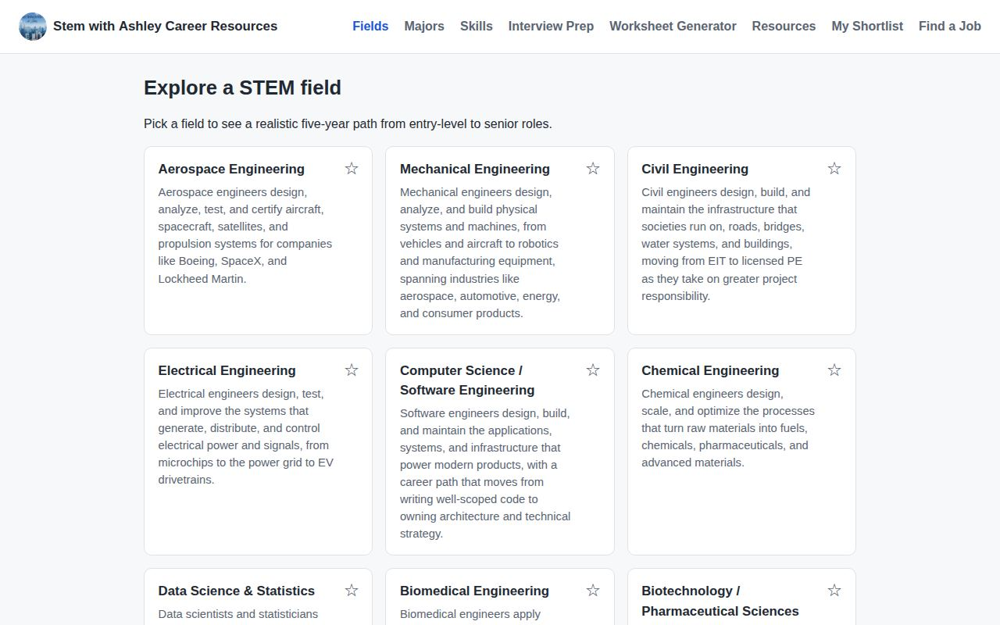

**Purpose:** show recent STEM graduates a realistic five-year career path in 12
fields, from engineering to health sciences and project management.

**Where:** the home page, or **Fields** in the menu.

**How to use it:**
1. Click any field card, e.g. *Biomedical Engineering*.
2. Read the **five-year pathway**: four stages from entry level (years 0–1) to
   senior/leadership (5+), each with typical job titles and what the work involves.

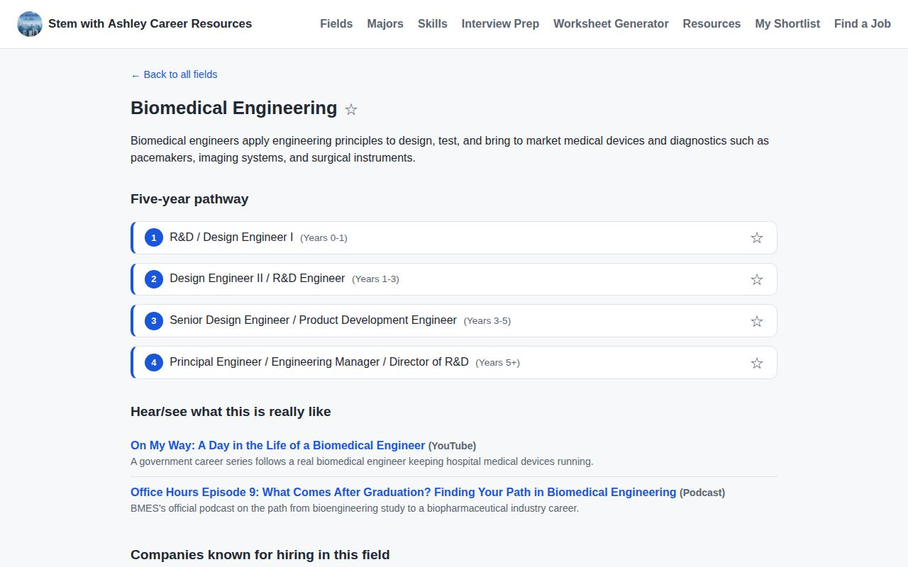

3. Scroll down for **"Hear/see what this is really like"** (YouTube and podcast
   picks), **companies that hire**, **certifications** (each name links to the
   official provider page), **graduate programs and schools**, **conferences**, and
   **professional organizations**.

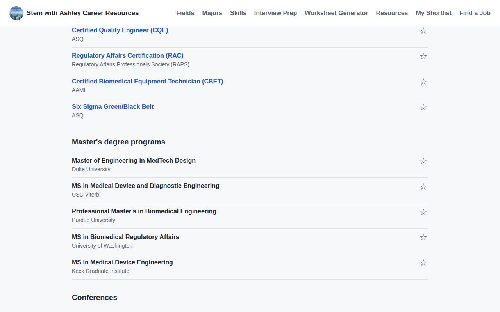

4. Click the **☆ star** next to anything to save it to **My Shortlist**.

**Limitations:** pathways are typical examples, not guarantees. Titles and timing
vary by company. Always check certification details on the provider's site.

## 2. College Majors Explorer

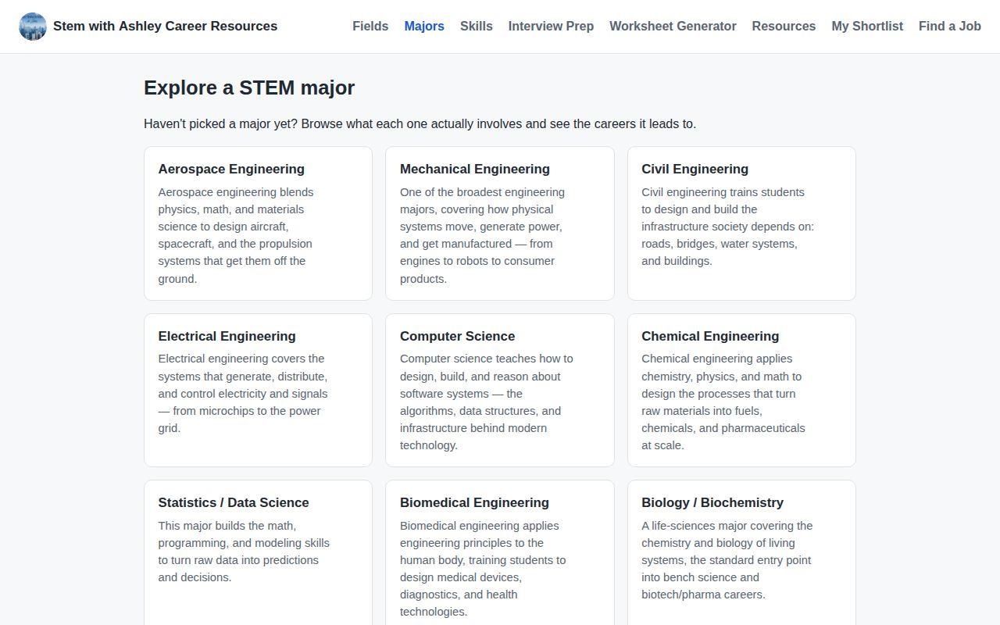

**Purpose:** help students who are still choosing a major see what each one
involves and which careers it leads to.

**Where:** **Majors** in the menu.

**How to use it:** click a major to see a summary, typical courses, why students
choose it, and links to the career fields it leads to. Click a field to jump to its
roadmap.

## 3. Developmental Skills

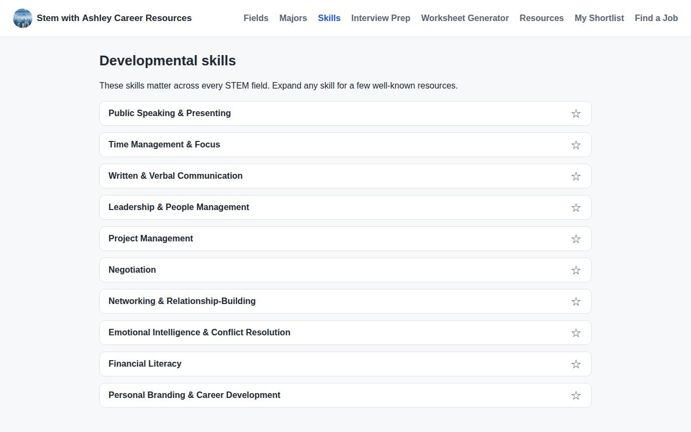

**Purpose:** the non-technical skills every STEM career needs (public speaking,
leadership, and more), each with recommended books, courses, and organizations.

**Where:** **Skills** in the menu. Click a skill to expand its resources. Star a
skill to save it.

## 4. Interview Preparation

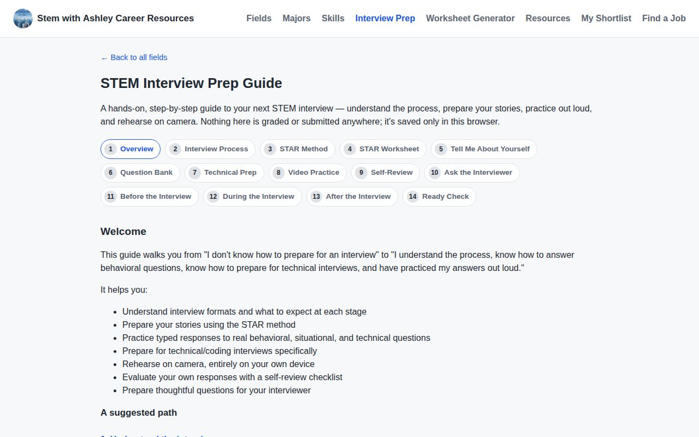

**Purpose:** a 14-step guide that takes a student from "what happens in an
interview" to a ready-check before the real thing.

**Where:** **Interview Prep** in the menu. Use **Next / Back** at the bottom of each
step, or the step list at the top.

| Step | What it covers |
| --- | --- |
| 1 Welcome | How the guide works |
| 2 The Interview Process | The typical stages: recruiter screen, behavioral, technical, and more |
| 3 The STAR Method | Situation, Task, Action, Result: why it works, common mistakes, an example |
| 4 STAR Worksheet | Build your own STAR answers in guided boxes |
| 5 "Tell Me About Yourself" | Present → Past → Future builder |
| 6 Question Bank | 120+ questions with tips. Search, filter by category/difficulty, mark favorites and "practiced" |
| 7 Technical Prep | What to expect in coding/technical interviews by role |
| 8 Video Practice | Record yourself answering (camera + microphone) |
| 9 Self-Review | Checklists to judge your own answers |
| 10 Questions to Ask | Good questions for the interviewer |
| 11–13 Before / During / After | Checklists for each part of interview day |
| 14 Ready Check | A summary of what you've completed |

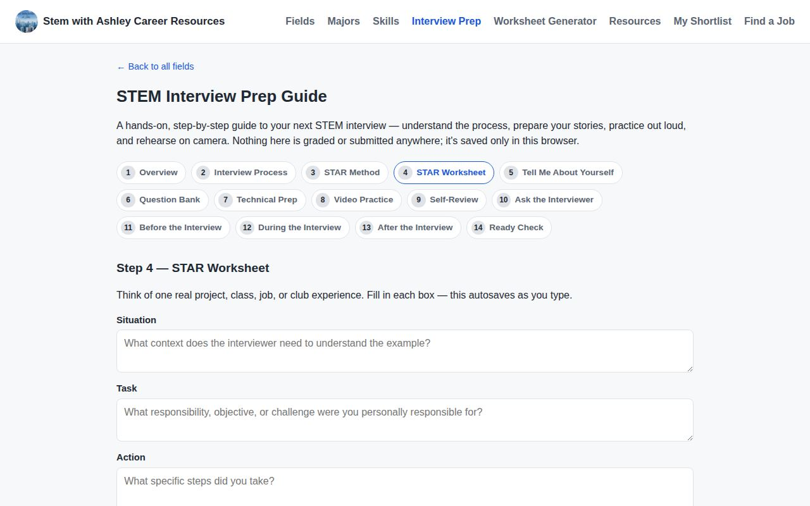

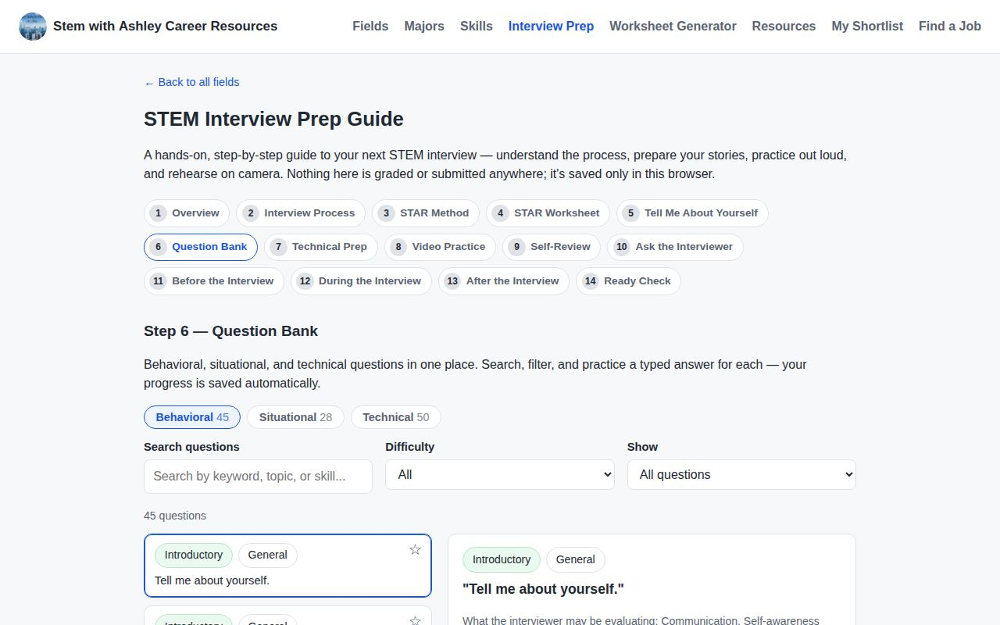

**Video practice:** the browser asks for camera and microphone permission. The
video is played back **only on that device** and is deleted when you leave the step.
Nothing is uploaded. If recording isn't supported (some older browsers), the page
says so.

**Where progress is stored:** answers, favorites, and checklist ticks are saved in
the student's own browser.

## 5. Worksheet Generator

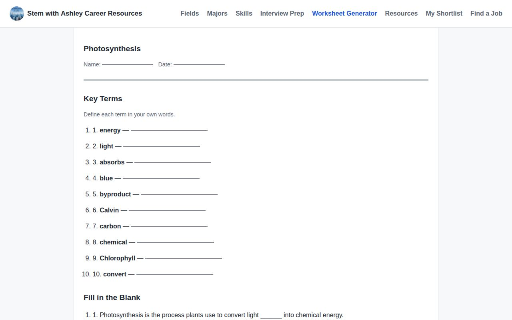

**Purpose:** turn class notes into a printable practice worksheet with an answer
key.

**Where:** **Worksheet Generator** in the menu.

**How to use it:**
1. Type a title (e.g. "Photosynthesis").
2. Paste notes or a lesson summary. A few full sentences work best.
3. Choose the number of questions (4–15) and the difficulty.
4. Click **Generate Worksheet**.
5. Tick **Show answer key** if you want answers, then **Print Worksheet** (or save
   as PDF from the print window).

**Limitations:** questions are built from the sentences you paste, using simple
rules (no AI). Review them before giving them to students. Notes stay in the
browser.

## 6. Resources

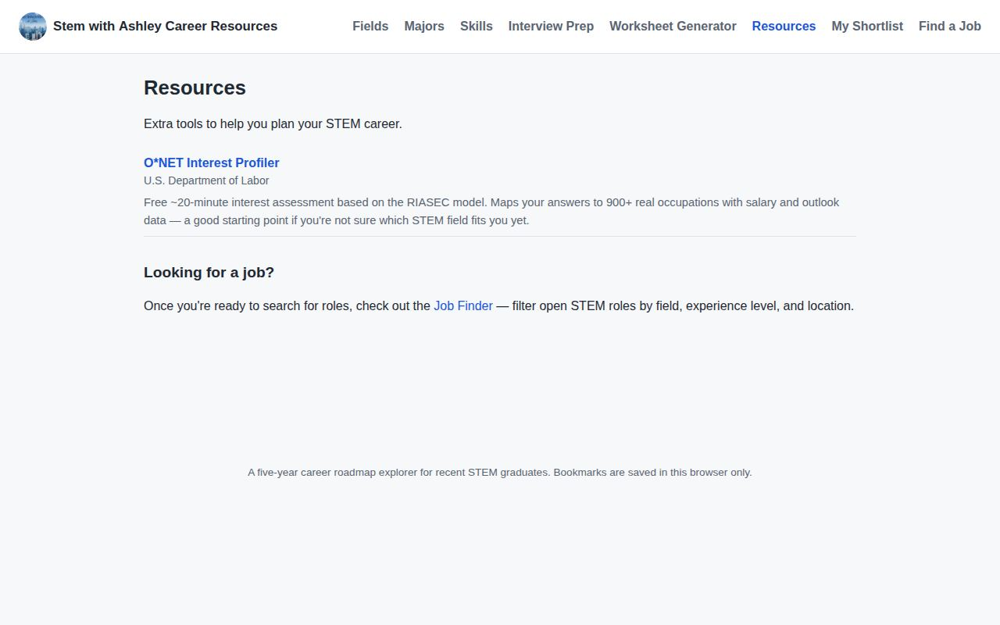

**Purpose:** trusted career-exploration websites (for example, the O\*NET Interest
Profiler) with short descriptions. **Where:** **Resources** in the menu.

## 7. Job Finder

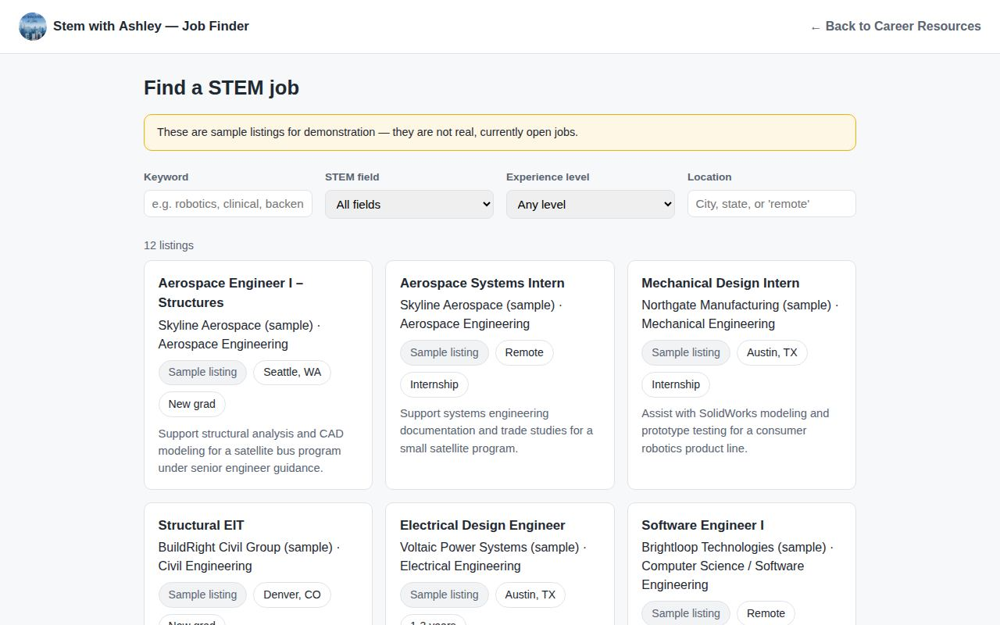

**Purpose:** search early-career STEM jobs by keyword, field, experience level, and
location.

**Where:** **Find a Job** in the menu.

**How to use it:** type a keyword or choose filters. The list updates as you type.

**Sample vs. real listings:**
- **Sample listing** (grey label): an illustrative example, **not a real job**.
  Company names include "(sample)".
- **Real listing** (green label): includes **View the original posting** and the
  date it was last checked. Always confirm on the employer's site before applying.

**Limitation:** this is not a live job feed. Listings are added by hand in the
admin dashboard.

## 8. My Shortlist

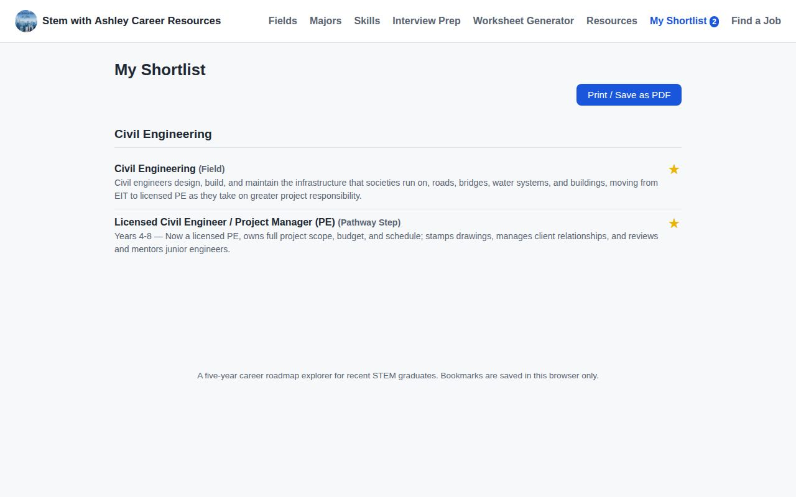

**Purpose:** collect everything a student starred (fields, pathway stages,
certifications, skills, and more) to bring to a career-coaching conversation.

**Where:** **My Shortlist** in the menu. The number badge shows how many items are
saved.

**How to use it:** click **Print / Save as PDF** to print or save it. Click a star
again to remove an item.

**Limitation:** the shortlist is saved in that browser on that device only.
Clearing browsing data removes it.
